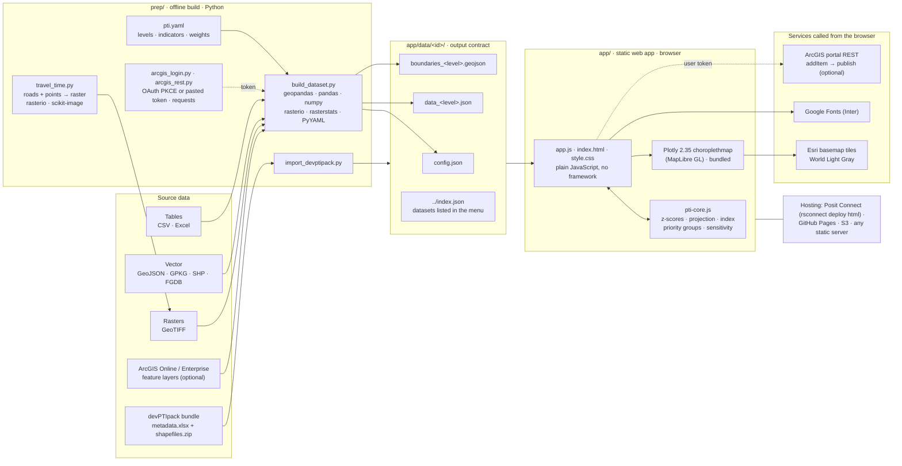

# Architecture

The PTI Builder has two halves that share only a set of files. An offline Python build turns source data and a `pti.yaml` into JSON and GeoJSON. A static web app reads those files and computes the index in the browser. Nothing runs on a server: any host that serves files can serve the app.

## Components

| Layer | Component | What it does | Technology |
|---|---|---|---|
| Build | `prep/build_dataset.py` | reads `pti.yaml`; loads boundaries per level; pulls each indicator from its source; aggregates or takes values supplied per level; computes raster summaries per unit; checks coverage; simplifies geometry; writes the output files | Python 3, geopandas (pyogrio), pandas, numpy, PyYAML; rasterio + rasterstats for raster sources |
| Build | `prep/travel_time.py` | builds a travel-time raster from a road network and destination points (cheapest path on an equal-area grid) | rasterio, geopandas, scikit-image (`MCP_Geometric`) |
| Build | `prep/import_devptipack.py` | converts a devPTIpack deployment bundle into the same output files | Python, reuses `build_dataset.py` |
| Build | `prep/arcgis_login.py`, `arcgis_rest.py`, `list_webmap_layers.py` | optional: sign in, read feature layers and web maps, draft `pti.yaml` entries | requests, ArcGIS REST API; token stored in `~/.pti-builder/`, never in the repository |
| Contract | `app/data/<id>/` | `config.json` (app settings, levels, indicators, pillars, schemes), `data_<level>.json` (one row per unit), `boundaries_<level>.geojson` | JSON, GeoJSON (WGS84) |
| App | `app/js/pti-core.js` | the devPTIpack method, independent of the interface, so it is tested in Node | plain JavaScript |
| App | `app/js/app.js`, `index.html`, `css/style.css` | weights panel, level switch, map, table, sensitivity, downloads (CSV, GeoJSON, run notes), saved weight sets, optional publish to ArcGIS | plain JavaScript, HTML, CSS; saved weights in the browser's `localStorage` |
| App | `app/js/vendor/plotly-2.35.2.min.js` | map rendering; the only library, bundled so the app needs no CDN | Plotly.js `choroplethmap` (MapLibre GL) |
| External | basemap | light-grey tiles under the map | Esri World Light Gray tile service |
| External | fonts | Inter typeface; falls back to system fonts where blocked | Google Fonts |
| External | publish to ArcGIS | uploads the current results as GeoJSON or CSV and publishes a hosted feature layer, shared only with the user | ArcGIS portal REST (`addItem`, `publish`), user-supplied token |
| Hosting | `app/` | any static host; Posit Connect via `rsconnect deploy html app/` | — |
| Tests | `tests/` | method and devPTIpack parity against R reference results; build tests | Node 18+ `node --test`; pytest; R (devPTIpack) to regenerate fixtures |

## Design choices

- **Compute in the browser.** The index is a weighted sum of z-scores over at most a few thousand units per level, which takes milliseconds. Doing it client-side means no server to run or secure, and weights never leave the user's machine.
- **A file contract between build and app.** The app knows nothing about source formats or ArcGIS; the build knows nothing about the interface. A new data source is a build change only.
- **One bundled library.** Plotly ships with MapLibre, so the map needs no CDN. That matters on servers that block CDNs.
- **Data is public to viewers.** Whoever can open the page can download everything under `app/data/`. Access control is the host's job (for example, Posit Connect viewer lists).
